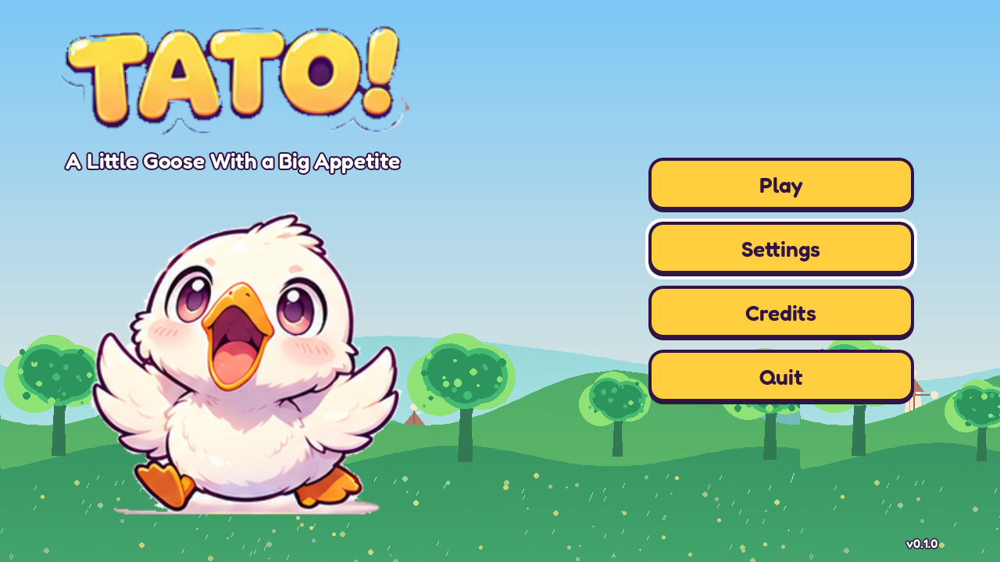
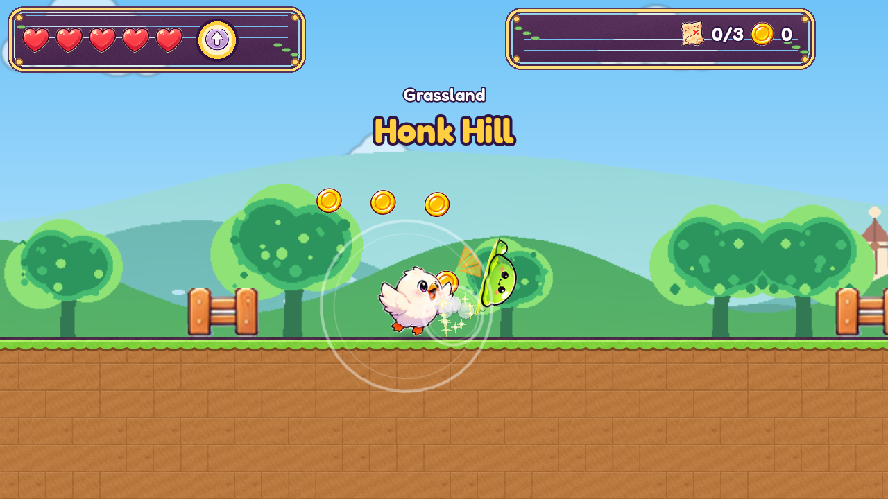
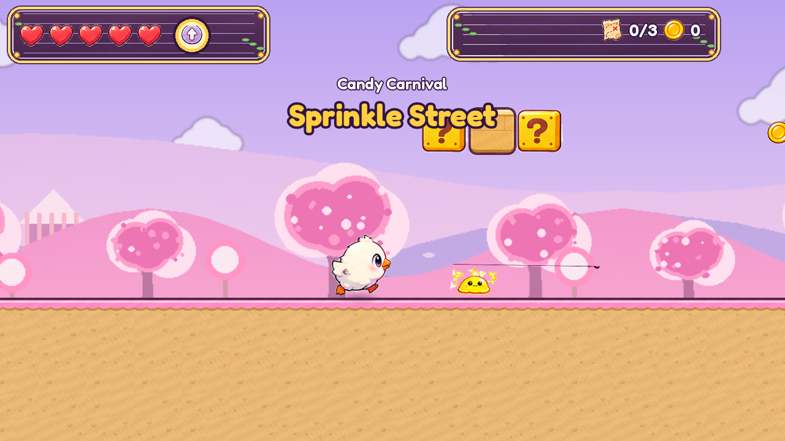
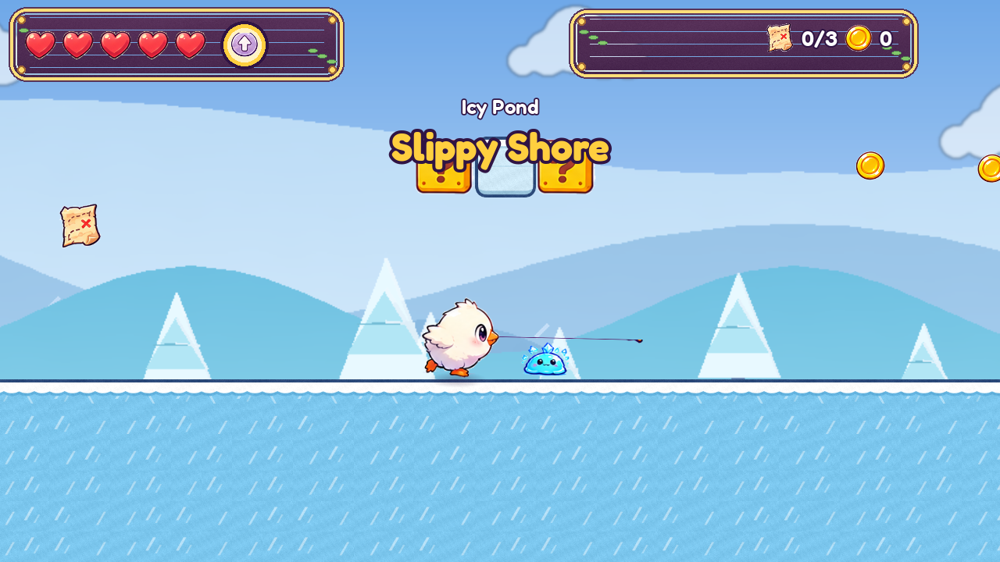
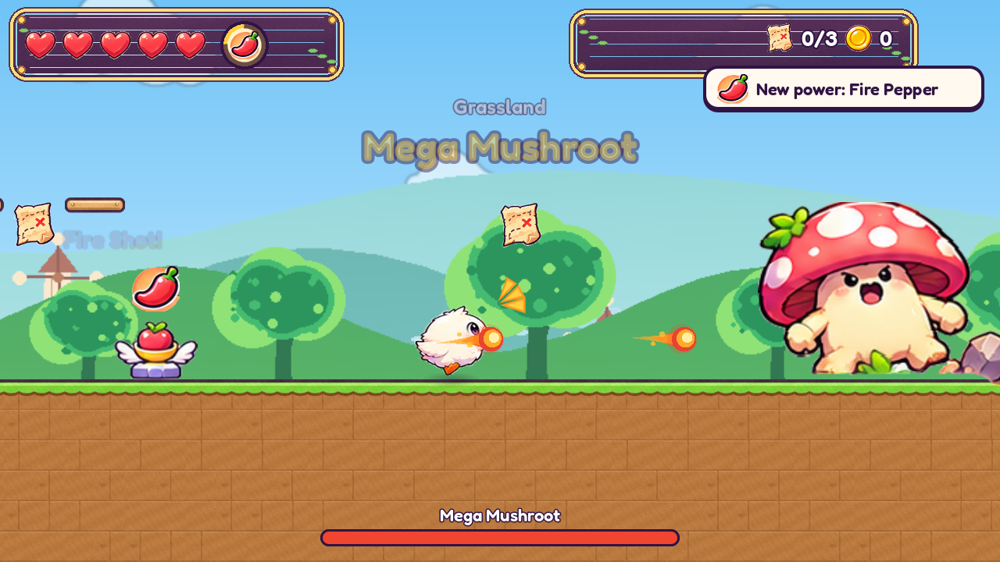

# TATO! — A Little Goose With a Big Appetite

A bright, original side-scrolling action platformer for all ages, made with Godot 4.
Tato eats magical foods to get attack powers, bops his way through six worlds, and
brings home the six Flavor Pages of the Great Recipe Book.

**Three buttons: move, jump, attack. One power at a time. Five hearts. No lives.**
Plays in a browser (including iPad and iPhone), and on Windows, macOS and Linux.

**Play in your browser:** https://nicky-dimes.github.io/tato-game/
(iPad and iPhone need **iOS / iPadOS 16.4 or newer**; hold the device sideways; the first load is about 100 MB).

> **Status: version 0.4.0, a playable work in progress.** All six worlds, 30 stages and
> six bosses can be played from start to finish. Art, animation and stage pacing are
> still being improved, and it has not yet been tuned on older phones and tablets.
> [`DEVELOPMENT_STATUS.md`](DEVELOPMENT_STATUS.md) and [`CHANGELOG.md`](CHANGELOG.md) say
> what is built and tested. How the site is published: [`docs/PUBLISHING.md`](docs/PUBLISHING.md).

## Screenshots

Real captures from the desktop build (`-- --shot=`), current art.

| | |
|---|---|
|  |  |
|  |  |
|  | |

## What is in the game

- 6 worlds x (3 stages + bonus stage + boss) = **30 stages**, plus the Home Nest and a trial room
- **12 attack power-ups**, one active at a time, with 66 named Flavor Bursts when powers swap
- **18 creatures** (plus fire, ice and shock slimes) and **6 bosses** with three attacks each
- Coins, hidden Treasure Notes, Stars, keys, Question Blocks and 20 kinds of level pickup
- Checkpoint bells, auto-save, three save slots, a Snack Notebook, a wardrobe of hats
- Keyboard, gamepad (both remappable) and touch controls
- Cozy Mode, captions, reduced motion and other comfort options
- Original sound effects and music, generated by a script in this repo

Full description: [`docs/GAME_DESIGN.md`](docs/GAME_DESIGN.md) · Controls: [`docs/CONTROLS.md`](docs/CONTROLS.md)

## Play from source

1. Install **Godot 4.7.2** (standard build, not .NET) — https://godotengine.org/download
2. Open `game/project.godot` in Godot and press **Play** (F5).

Or from a terminal:

```bash
godot --path game
```

## Build, test, export

Everything is in [`docs/DEVELOPMENT.md`](docs/DEVELOPMENT.md). The short version:

```bash
godot --headless --path game --import
godot --headless --fixed-fps 60 --path game res://tests/TestRunner.tscn
tools/build.sh web
```

## Repository layout

```
game/        the Godot project (scripts, scenes, data, assets, tests)
tools/       art cutting, art generation, audio generation, stage builder, build script
docs/        design, controls, development notes, status, art pipeline and rights
assets/      the owner's approved art boards (the source of the game's pictures)
.github/     CI: tests on every push, web build + GitHub Pages, tagged release builds
```

## Art and audio

Every character, creature, item and boss picture is **cut from the owner's own art
boards** in `assets/reference/` (see [`docs/ART_PIPELINE.md`](docs/ART_PIPELINE.md)).
Terrain tiles and parallax backgrounds are generated to match. Sound and music are
generated by `tools/audio/make_audio.mjs`. Sources and rights are listed in
[`docs/ASSET_MANIFEST.md`](docs/ASSET_MANIFEST.md).

## Licence

No public licence has been chosen yet: **all rights reserved** by the owner for now
(see [`LICENSE.md`](LICENSE.md)). Third-party pieces keep their own licences:
Godot Engine (MIT) and the Fredoka font (SIL OFL 1.1).
